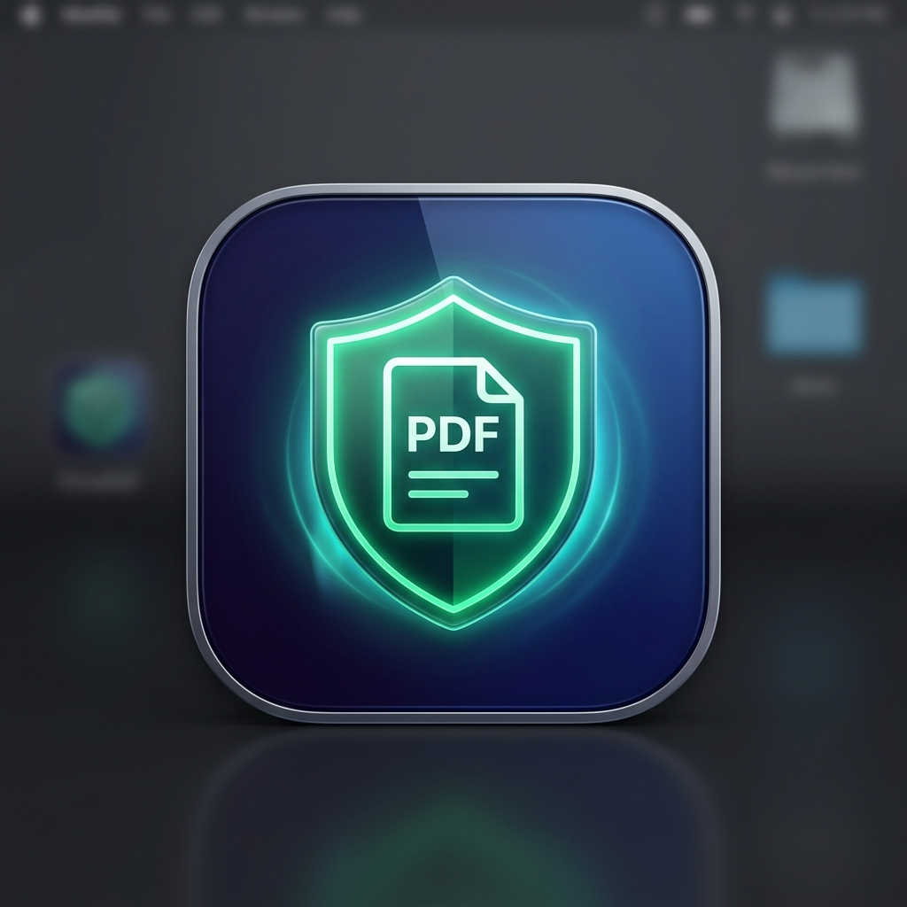

# 🛡️ PrivaPDF

<p align="center">
  
</p>

<p align="center">
  <strong>The Private, 100% Offline PDF & Document Studio.</strong><br>
  Convert Excel to PDF, Images to PDF, Word to Excel, Merge & Split — entirely offline on your MacBook & Windows PC with zero data leakage.
</p>

<p align="center">
  <a href="https://github.com/djakamiriandi/PrivaPDF/releases/latest"></a>
  <a href="https://github.com/djakamiriandi/PrivaPDF/releases/latest"></a>
  <a href="https://github.com/djakamiriandi/PrivaPDF"></a>
</p>

<p align="center">
  <a href="https://github.com/djakamiriandi/PrivaPDF/releases"></a>
  
  
  <a href="LICENSE"></a>
  <a href="SECURITY.md"></a>
  
</p>

---

## ⚡ Quick Download & Install (For Everyone / Mac & Windows)

> [!IMPORTANT]
> **New to GitHub / Bukan Programmer?**  
> **JANGAN** klik tombol hijau `Code -> Download ZIP` di atas! Itu hanya berisi kode sumber mentah (*source code*) dan tidak bisa langsung dijalankan tanpa Node.js.  
>  
> 👉 **Unduh aplikasi desktop siap pakai langsung di sini:**  
> 🍏 [**Download untuk MacBook / macOS (PrivaPDF-1.0.1-arm64.dmg)**](https://github.com/djakamiriandi/PrivaPDF/releases/latest)  
> 🪟 [**Download untuk Windows (PrivaPDF-Windows-x64.zip)**](https://github.com/djakamiriandi/PrivaPDF/releases/latest)

---

### 🍏 Panduan Memasang di MacBook (macOS):
1. **Unduh Installer**: Klik tautan download Mac di atas untuk mendapatkan `PrivaPDF-1.0.0-arm64.dmg`.
2. **Pasang ke Mac**: Klik dua kali file `.dmg`, lalu **tarik (*drag & drop*) icon PrivaPDF ke folder Applications**.
3. **Buka Aplikasi**: Buka PrivaPDF dari Launchpad atau folder Applications.
   * *Jika muncul pesan "App is from an unidentified developer" pada pembukaan pertama*:  
     Cukup **Klik Kanan (Control + Klik)** icon PrivaPDF di Applications ➡️ pilih **Open** ➡️ klik **Open**. *(Hanya perlu 1 kali saja)*.

---

### 🪟 Panduan Memasang di Windows PC:
1. **Unduh Paket**: Klik tautan download Windows di atas untuk mengunduh `PrivaPDF-Windows-x64.zip`.
2. **Ekstrak File**: Klik kanan file `.zip` ➡️ pilih **"Extract All..."** (Ekstrak Semua).
3. **Buka Aplikasi**: Masuk ke folder hasil ekstrak, lalu **klik dua kali `PrivaPDF.exe`**.
   * *Aplikasi langsung terbuka tanpa instalasi tambahan dan tanpa perlu koneksi internet!*

---

## 💡 The Problem & The PrivaPDF Solution

Situs konversi PDF populer seperti **iLovePDF**, **Smallpdf**, atau **Adobe Online** sangat mudah digunakan, namun memiliki risiko privasi yang signifikan: setiap dokumen keuangan, kontrak legal, atau data pribadi yang Anda unggah **dikirim ke server pihak ketiga di cloud**.

**PrivaPDF** memberikan solusi modern yang menggabungkan kemudahan antarmuka bergaya iLovePDF dengan **keamanan data mutlak**:

| Fitur | Cloud Converters (iLovePDF, Smallpdf) | Stirling-PDF (Self-hosted) | PrivaPDF 🛡️ |
| :--- | :--- | :--- | :--- |
| **Dukungan Platform** | Hanya Web Browser | Butuh Docker / Linux Server | **Native macOS App + Windows PC + Web** |
| **Lokasi Pemrosesan** | Server Cloud Publik (data dikirim ke luar) | Server lokal (butuh Docker & RAM besar) | **100% di RAM Laptop Sendiri** |
| **Koneksi Internet** | Wajib Online | Butuh Jaringan Lokal | **Bisa Jalan di Mode Pesawat (Airplane Mode)** |
| **Peluang Kebocoran Data** | Berisiko tinggi untuk data sensitif/rahasia | Rendah | **Nol Mutlak (Diblokir CSP `connect-src 'none'`)** |
| **Kemudahan Penggunaan** | Sangat mudah (cukup buka browser) | Rumit (butuh setup Docker / Java) | **Sangat mudah (Klik .dmg / .exe)** |
| **Kecepatan** | Tergantung kecepatan upload/download | Sedang | **Instan (Langsung diproses chip laptop)** |
| **Biaya & Iklan** | Terbatas (ada kuota gratis & iklan) | Gratis open-source | **100% Gratis, Tanpa Iklan, Tanpa Kuota** |

---

## ✨ Fitur & Alat Unggulan

### 📊 1. Excel ke PDF (`.xlsx`, `.xls` ➡️ `.pdf`)
* Membaca workbook multi-sheet secara offline via SheetJS.
* Pilihan konversi: sheet tertentu atau seluruh sheet sekaligus.
* Pengaturan orientasi halaman (Landscape / Portrait) dan ukuran kertas (A4 / Letter).
* 4 Tema tabel terformat: *Modern Indigo, Emerald Fresh, Professional Dark, Minimal Gray*.
* Header tabel berulang otomatis pada dokumen berhalaman panjang.

### 🖼️ 2. Gambar ke PDF (`.jpg`, `.jpeg`, `.png`, `.webp` ➡️ `.pdf`)
* Unggah banyak foto sekaligus dengan thumbnail interaktif.
* Atur susunan urutan foto (geser naik / turun) sebelum digabung.
* Opsi batas margin: Tanpa Margin (Full-bleed), Tipis, atau Normal.
* Opsi output: Gabungkan seluruh gambar menjadi 1 PDF multi-halaman atau pisahkan per gambar dalam bundel ZIP.

### 📑 3. PDF ke Gambar (`.pdf` ➡️ PNG / JPG)
* Me-render setiap halaman PDF menjadi gambar resolusi tinggi menggunakan engine Mozilla PDF.js lokal.
* Pilihan resolusi: **Standard (150 DPI)** atau **Ultra HD Print (300 DPI)**.
* Tombol satu-klik untuk mengunduh semua halaman dalam arsip `.zip`.

### 🔗 4. Gabungkan PDF (Merge PDF)
* Satukan dua atau lebih dokumen PDF menjadi satu file utuh.
* Atur urutan file dengan tombol panah naik/turun yang intuitif.

### ✂️ 5. Pisahkan PDF (Split PDF)
* **Mode Rentang Kustom**: Ambil halaman tertentu yang diinginkan (contoh: `1-3, 5, 8-10`).
* **Mode Pisah Semua Halaman**: Mengekstrak setiap lembar menjadi file PDF mandiri dalam satu file `.zip`.

### 📝 6. Word ke Excel (`.docx` ➡️ `.xlsx`)
* Mengekstrak tabel OpenXML dari dokumen Word secara otomatis menjadi lembar kerja Excel (`Table_1`, `Table_2`).
* Memetakan paragraf dan teks terstruktur ke baris spreadsheet rapi.

### 📄 7. Excel ke Word (`.xlsx` ➡️ `.docx`)
* Mengonversi tabel data dari spreadsheet Excel menjadi dokumen Microsoft Word native (`.docx`) lengkap dengan tabel terformat rapi dan judul sheet.

---

## 🔒 Jaminan Keamanan Sistem (*Zero Telemetry*)

1. **Content Security Policy (CSP) Ketat**:
   Di dalam `index.html` terpasang konfigurasi keamanan:
   ```html
   <meta http-equiv="Content-Security-Policy" content="default-src 'self' blob: data:; ... connect-src 'none'; ...">
   ```
   *Aturan `connect-src 'none'` menjamin bahwa secara sistemik browser menolak mentah-mentah segala transmisi data keluar (`fetch()`, `XMLHttpRequest`, atau WebSocket).*
2. **In-Memory Volatile Processing**:
   Semua file hanya hidup sementara di RAM laptop selama sesi konversi.
3. **Pembersihan Memori Otomatis**:
   Setiap kali file diunduh atau sesi direset, referensi objek biner langsung dihapus via `URL.revokeObjectURL()` untuk mencegah penumpukan RAM.

---

## 💻 Menjalankan dari Source Code (Untuk Pengembang)

Jika Anda ingin memodifikasi atau mengembangkan PrivaPDF secara lokal:

```bash
# 1. Clone repository ini
git clone https://github.com/djakamiriandi/PrivaPDF.git
cd PrivaPDF

# 2. Pasang dependensi
npm install

# 3. Jalankan server lokal
npm run dev

# 4. Jalankan aplikasi desktop Electron (Mac / Windows)
npm run electron:start

# 5. Build installer desktop:
npm run dist:mac  # Menghasilkan .dmg untuk macOS
npm run dist:win  # Menghasilkan .exe untuk Windows
```

---

## 📄 Lisensi

Didistribusikan di bawah lisensi **MIT**. Lihat [LICENSE](LICENSE) untuk informasi lebih lanjut.
