# Design Specification: PrivaPDF

**Date:** 2026-10-27  
**Project Name:** PrivaPDF  
**Target Location:** `/Users/jakamiriandi/Desktop/PrivaPDF`  
**Status:** Approved Design  

---

## 1. Executive Summary & Core Value Proposition

**PrivaPDF** is a modern, privacy-first, 100% client-side web application for document conversions and PDF manipulations—functioning similarly to iLovePDF and Stirling-PDF, but operating entirely offline on the user's laptop.

### Key Guarantees:
1. **Zero Data Leakage:** All file parsing, binary manipulations, and PDF generations occur strictly within browser memory (`ArrayBuffer` / `Uint8Array`). No file is ever uploaded to a remote server or third-party cloud.
2. **True Offline Operation:** Operates without an active internet connection (air-gapped / airplane mode compatible).
3. **Hardware Privacy Enforcement:** Content Security Policy (CSP) restricts outbound network calls (`connect-src 'none'`), programmatically preventing telemetry, analytics, and data exfiltration.

---

## 2. High-Level Architecture & Data Flow

```mermaid
flowchart TD
    subgraph Browser["Local Browser Environment (Client-Side Only)"]
        UI["PrivaPDF UI (React + TypeScript + Vite)"]
        Dropzone["File Dropzone (ArrayBuffer / Blob)"]
        CSP["Content Security Policy (connect-src 'none')"]
        
        subgraph Engine["In-Memory Conversion Engines"]
            E2P["Excel to PDF (SheetJS + jsPDF-AutoTable)"]
            I2P["Image to PDF (HTML5 Canvas + pdf-lib)"]
            P2I["PDF to Image (Mozilla PDF.js)"]
            MPDF["Merge PDF (pdf-lib)"]
            SPDF["Split PDF (pdf-lib)"]
            W2E["Word to Excel (Mammoth.js + SheetJS)"]
            E2W["Excel to Word (SheetJS + docx)"]
        end
        
        OutputBlob["Processed File Blob in RAM"]
        Downloader["Local Trigger: URL.createObjectURL()"]
        Cleaner["Memory Release: URL.revokeObjectURL()"]
    end

    UI --> Dropzone
    Dropzone --> Engine
    Engine --> OutputBlob
    OutputBlob --> Downloader
    Downloader --> Cleaner
```



### In-Memory Lifecycle:
1. **Intake:** User drops files into the file zone. File is read as an `ArrayBuffer` via `FileReader`.
2. **Processing:** The dedicated conversion module receives the binary data, executes transforms in-memory, and outputs a `Blob`.
3. **Delivery:** The browser triggers an automatic download via `URL.createObjectURL()`.
4. **Cleanup:** Immediately upon download trigger or modal dismiss, `URL.revokeObjectURL()` is executed to prevent RAM buildup.

---

## 3. Tool Suite & Module Specifications

PrivaPDF v1.0 features 7 essential tools across two categories:

### A. PDF Toolkit

#### 1. Excel to PDF (`.xlsx`, `.xls` ➡️ `.pdf`)
* **Libraries:** `xlsx` (SheetJS) + `jspdf` + `jspdf-autotable`
* **Features:**
  * Multi-sheet workbook detection: user can select a specific sheet or convert all sheets.
  * Paper orientation options: Portrait or Landscape.
  * Paper size: A4 or Letter.
  * Table styling themes: Clean Blue, Modern Dark, Minimal Gray, or Vibrant Emerald.
  * Handles auto-paging for wide/tall tables with repeating table headers.

#### 2. Image to PDF (`.jpg`, `.jpeg`, `.png`, `.webp` ➡️ `.pdf`)
* **Libraries:** `pdf-lib` + native HTML5 Image/Canvas
* **Features:**
  * Multi-image upload with thumbnail drag-and-drop reordering.
  * Orientation settings: Auto (match image aspect ratio), Portrait, Landscape.
  * Margins: None (borderless edge-to-edge), Small (10mm), Normal (20mm).
  * Output: Combined into a single multi-page PDF or separate PDFs packaged in a `.zip`.

#### 3. PDF to Image (`.pdf` ➡️ `.jpg` / `.png`)
* **Libraries:** `pdfjs-dist` + `jszip`
* **Features:**
  * Interactive page preview thumbnails.
  * Resolution selection: Standard (150 DPI) or High-Res Print (300 DPI).
  * Output options: Download individual page image or one-click "Download All Pages as ZIP".

#### 4. Merge PDF (Multiple `.pdf` ➡️ Single `.pdf`)
* **Libraries:** `pdf-lib`
* **Features:**
  * Add 2 or more PDF documents.
  * Drag-and-drop reordering of file sequence.
  * Displays file metadata (name, size, page count).
  * Fast binary concatenation in RAM without re-encoding text/vectors.

#### 5. Split PDF (`.pdf` ➡️ Multiple `.pdf` files)
* **Libraries:** `pdf-lib` + `jszip`
* **Features:**
  * **Mode A: Custom Page Ranges** (e.g., `1-3, 5, 8-10`) into a newly extracted PDF.
  * **Mode B: Split Every Page** into individual single-page PDFs, bundled into a `.zip`.

---

### B. Office Document Converters

#### 6. Word to Excel (`.docx` ➡️ `.xlsx`)
* **Libraries:** `mammoth` + `xlsx`
* **Features:**
  * Parses OpenXML tables (`<w:tbl>`) and paragraphs from `.docx`.
  * Extracts structured table data into multi-dimensional arrays.
  * Generates an Excel workbook with each Word table placed into its own worksheet (`Table_1`, `Table_2`, etc.).

#### 7. Excel to Word (`.xlsx` ➡️ `.docx`)
* **Libraries:** `xlsx` + `docx`
* **Features:**
  * Reads workbook sheets and cell values.
  * Creates native Microsoft Word `.docx` documents containing structured tables (`new Table()`).
  * Applies header row formatting, borders, and column width auto-calculation.

---

## 4. User Interface & Experience Design

### Visual Language & Aesthetic
* **Design Philosophy:** Clean, premium, modern SaaS aesthetic reminiscent of iLovePDF and Linear.
* **Palette:**
  * Primary: Electric Indigo (`#6366f1`) and Sapphire Blue (`#3b82f6`)
  * Excel Accent: Emerald Green (`#10b981`)
  * PDF Accent: Rose Crimson (`#f43f5e`)
  * Word Accent: Azure Blue (`#0284c7`)
  * Backgrounds: Light Mode (`#f8fafc`) and Dark Mode (`#0f172a` slate)
* **Status Elements:**
  * Persistent Security Badge in Navbar: `🛡️ 100% Offline & Private (Air-Gapped)`
  * Live status pill indicating that zero network packets are transmitted.

### Core Screens & Components
1. **Header/Navbar:** Brand logo, Privacy Badge with tooltip, Dark/Light mode toggle, Quick link to Help/Docs.
2. **Dashboard Tool Grid:** Responsive cards for all 7 tools, grouped by category ("PDF Tools" and "Office Converters"), with badges ("Popular", "New", "Convert").
3. **Workspace View / Active Tool Screen:**
   - Back button to return to dashboard.
   - Large drag-and-drop file upload zone with file type validation.
   - Interactive settings drawer (e.g. sheet selector, orientation, margins, DPI).
   - Live file list with remove/reorder actions.
   - Primary Action Button: "Convert Now", "Merge PDFs", "Extract Pages".
   - Progress Bar & Animation during processing.
   - Result Card: File size comparison, Preview, and "Download File" / "Download ZIP" button.

---

## 5. Security & Isolation Controls

1. **Content Security Policy:**
   ```html
   <meta http-equiv="Content-Security-Policy" content="default-src 'self'; script-src 'self' 'unsafe-inline'; style-src 'self' 'unsafe-inline'; img-src 'self' data: blob:; connect-src 'none'; font-src 'self' data:;">
   ```
2. **Zero Remote Dependencies at Runtime:**
   All fonts, icons, JavaScript chunks, WebAssembly (if any), and styles are bundled locally. No runtime calls to Google Fonts, CDNs, or analytics servers.
3. **Sanitization:** Input filenames are sanitized before being assigned to downloaded blobs to prevent path injection or illegal filesystem characters.

---

## 6. Directory Structure

```text
/Users/jakamiriandi/Desktop/PrivaPDF/
├── index.html
├── package.json
├── tsconfig.json
├── vite.config.ts
├── src/
│   ├── main.tsx
│   ├── App.tsx
│   ├── index.css
│   ├── types/
│   │   └── index.ts
│   ├── components/
│   │   ├── Navbar.tsx
│   │   ├── ToolCard.tsx
│   │   ├── Dropzone.tsx
│   │   ├── ToolModal.tsx
│   │   ├── PrivacyBadge.tsx
│   │   └── ResultView.tsx
│   ├── modules/
│   │   ├── excelToPdf.ts
│   │   ├── imageToPdf.ts
│   │   ├── pdfToImage.ts
│   │   ├── mergePdf.ts
│   │   ├── splitPdf.ts
│   │   ├── wordToExcel.ts
│   │   └── excelToWord.ts
│   └── utils/
│       ├── downloadHelper.ts
│       └── fileSanitizer.ts
└── docs/
    └── superpowers/specs/
        └── 2026-10-27-privapdf-design.md
```

---

## 7. Verification & Testing Criteria

1. **Excel to PDF:** Verify `.xlsx` with multiple sheets converts to a paginated PDF with readable tables.
2. **Image to PDF:** Verify 3+ images (JPG & PNG) convert to a multi-page PDF with correct orientation.
3. **PDF to Image:** Verify multi-page PDF renders pages into PNGs and can be downloaded as a `.zip`.
4. **Merge PDF:** Verify merging 2 PDFs produces a single valid PDF with correct page sequence.
5. **Split PDF:** Verify splitting extracts selected page ranges accurately into new PDFs.
6. **Word to Excel:** Verify a `.docx` with a table parses into an `.xlsx` workbook.
7. **Excel to Word:** Verify an `.xlsx` converts into a `.docx` containing styled native tables.
8. **Network Isolation:** Confirm DevTools Network tab shows 0 outbound requests during application launch and all conversion operations.
